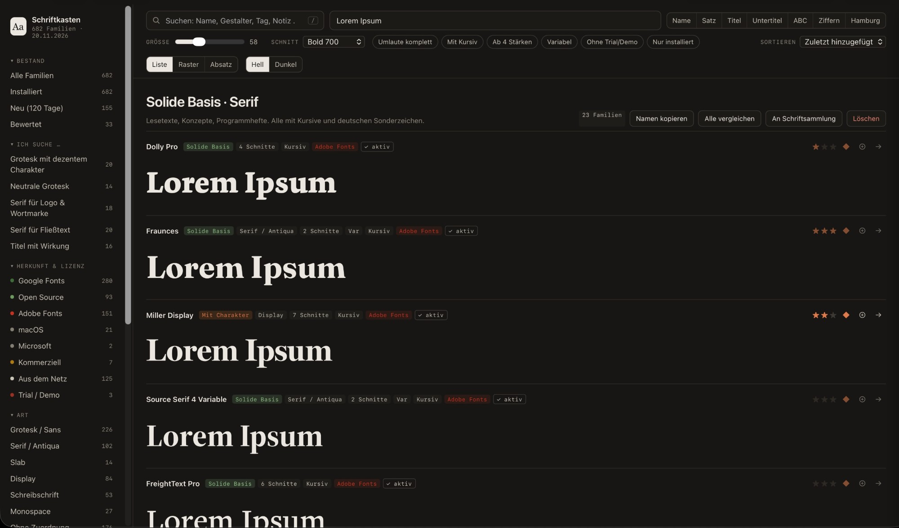
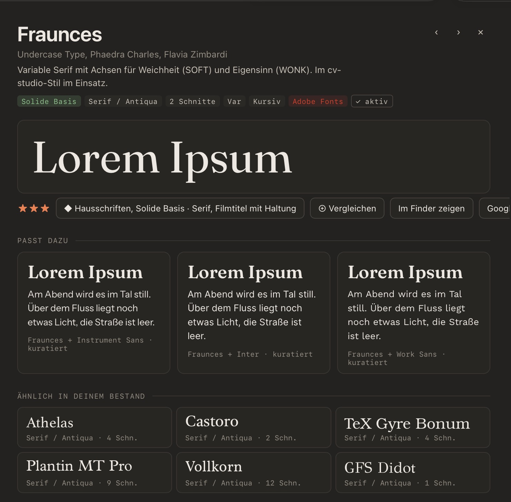
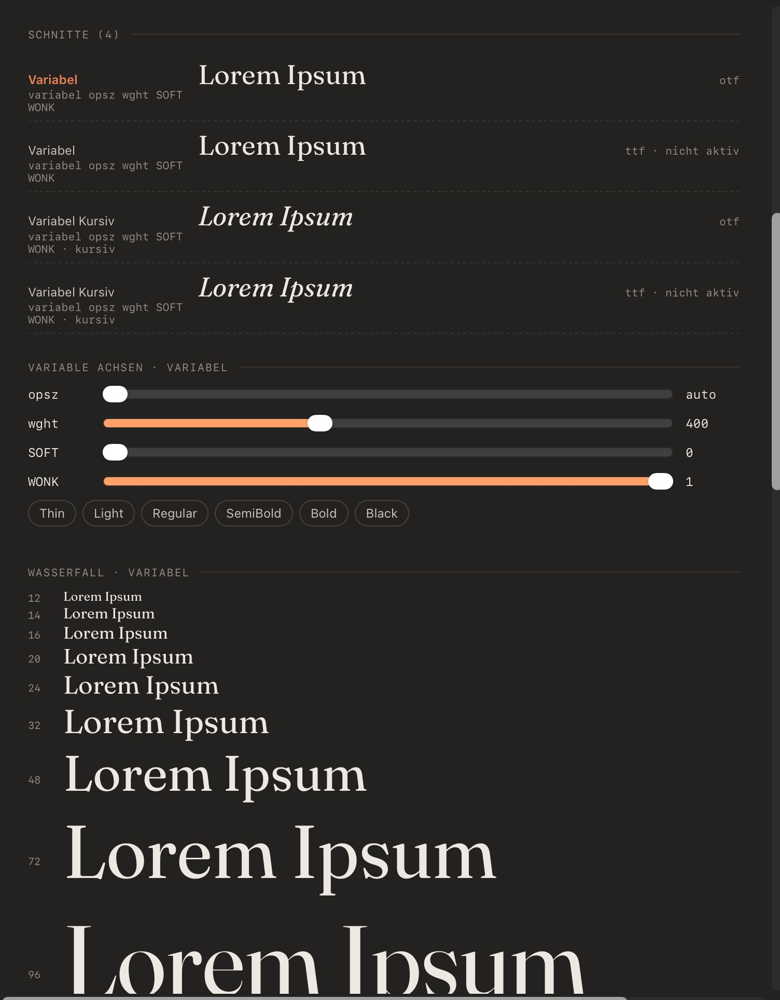
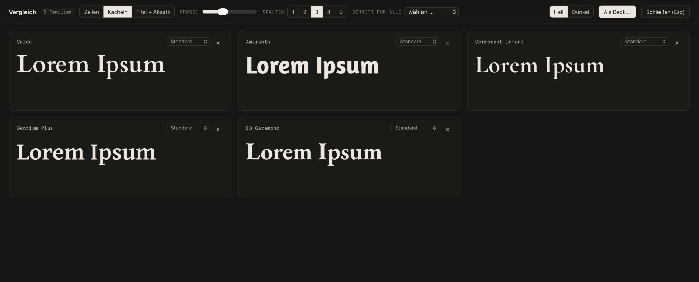

# Schriftkasten

Ein kleines Werkzeug für den Mac, um die eigenen Schriften wiederzufinden, nebeneinanderzulegen und aufzuräumen. Es läuft lokal, ohne Konto und ohne Cloud.



## Warum ich ihn gebaut habe

Schriften landen mit der Zeit überall: im Benutzerordner, im Systemordner, in FontBase, in einem Archiv. Bei Adobe Fonts liegen sie in einem versteckten Ordner, und die Dateien heißen dort nur Nummern. Wer für Kunden arbeitet, will vor dem Einsatz wissen, ob eine Schrift freigegeben ist und ob ä, ö, ü und ß vorhanden sind. Und wer eine Schrift für ein Projekt sucht, will sie in seinem eigenen Text sehen, neben zwei, drei Alternativen.

Die Schriftsammlung von macOS (Font Book) ist dafür nicht gebaut. Sie verwaltet installierte Schriften, und das macht sie gut. Aber:

- Sie kennt die Adobe-Fonts-Ordner nicht, und was in FontBase oder im Archiv liegt, auch nicht.
- Sie sagt nicht, woher eine Schrift kommt und ob man sie für Kundenarbeit nehmen darf.
- Bewertungen, Tags und Notizen gibt es nicht. Ich wollte festhalten können, warum eine Schrift in der engeren Wahl ist.
- Einen Schnitt, einen Text und eine Größe für alle Familien gleichzeitig zu setzen, geht nur umständlich.
- Zu einer Schrift passende Partner oder ähnliche Schriften aus dem eigenen Bestand schlägt sie nicht vor.

Der Schriftkasten ersetzt die Schriftsammlung nicht. Er liegt davor: Er liest alles ein, hilft beim Aussuchen und gibt fertige Sammlungen an die Schriftsammlung zurück, damit sie in Pages, Keynote und TextEdit auftauchen.

## Was er macht

Er liest alle Schriftordner ein und zeigt jede Familie mit echter Vorschau im Browser. Du kannst

- nach Name, Foundry, Tag oder Notiz suchen und mit eigenem Text probesetzen,
- Schriften in Sammlungen ordnen, bewerten und nebeneinander vergleichen,
- die Herkunft sehen (Google Fonts, Adobe, macOS, kommerziell, Trial) und Hinweise zur Lizenz,
- ähnliche Schriften und passende Paarungen aus dem eigenen Bestand finden,
- doppelt installierte, unvollständige oder kaputte Schriften aufspüren und ins Archiv verschieben,
- Sammlungen an Font Book übergeben.

Gelöscht wird nichts. Aussortierte Schriften landen in `~/Schriften-Archiv` und lassen sich zurückholen.

### Eine Schrift im Detail

Alle Schnitte, Zeichen-Check für Umlaute und Sonderzeichen, Paarungen und ähnliche Schriften aus dem eigenen Bestand.



Bei variablen Schriften lassen sich die Achsen direkt verschieben. Darunter steht der Wasserfall von 12 bis 96 Pixel.



### Vergleichen

Beliebig viele Familien markieren und als Zeilen, Kacheln oder Titel mit Absatz nebeneinanderlegen. Der Text ist direkt editierbar, den Schnitt kann man pro Schrift oder für alle setzen. Als Deck lässt sich der Vergleich exportieren.



## Installieren

Du brauchst einen Mac mit macOS 11 oder neuer und Python 3.8 oder neuer. Die App sucht Python selbst, in dieser Reihenfolge: Homebrew, `/usr/local`, pyenv, zuletzt das Python der Xcode-Kommandozeilentools. Fehlt es, hilft einer dieser Wege:

```
brew install python
```

oder `xcode-select --install` für die Kommandozeilentools von Apple. Beim ersten Start braucht die App außerdem einmal Internet, um `fonttools`, `brotli` und für die Übergabe an Font Book `pyobjc` in eine eigene Umgebung zu laden. Dein übriges Python bleibt unberührt.

1. Unter [Releases](../../releases/latest) die ZIP-Datei laden und entpacken.
2. `Schriftkasten.app` in den Ordner `Programme` (oder `~/Applications`) ziehen.
3. Beim ersten Öffnen blockt macOS die App, weil sie nicht notarisiert ist. In den Systemeinstellungen unter Datenschutz & Sicherheit auf „Trotzdem öffnen“ klicken.
4. Der erste Start dauert etwa eine Minute, weil die Python-Umgebung eingerichtet wird. Danach öffnet sich die Oberfläche im Browser. Beenden kannst du links unten mit „Beenden“.

Aus dem Quellcode: `./macos/build_app.sh` baut die App nach `dist/`. Dafür braucht es die Kommandozeilentools (für `swiftc`, das die Mitteilungen baut).

## Datenschutz

Der Dienst hört nur auf `127.0.0.1`. Deine Sammlungen, Bewertungen und Notizen liegen in `~/Library/Application Support/Schriftkasten/`. Nichts wird hochgeladen.

## Mehr

Alle Funktionen, Tastenkürzel und die Technik dahinter stehen im [Handbuch](docs/HANDBUCH.md).
